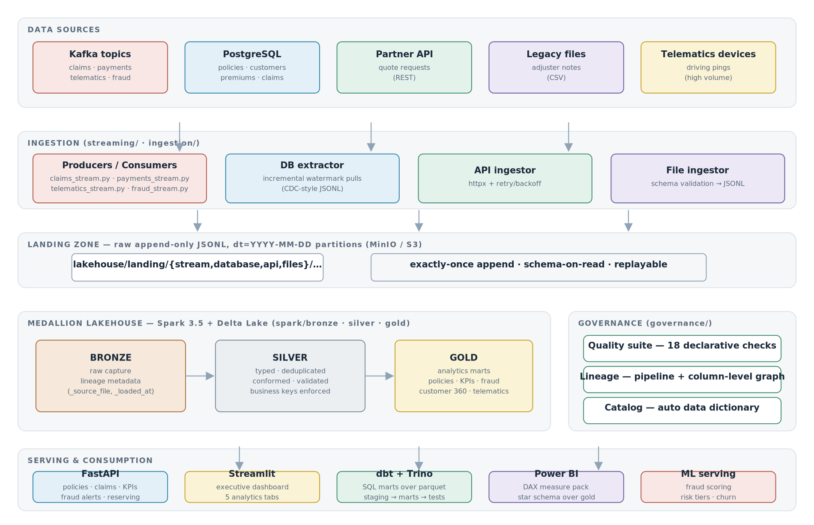
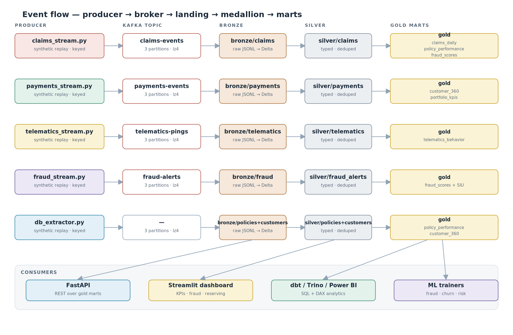
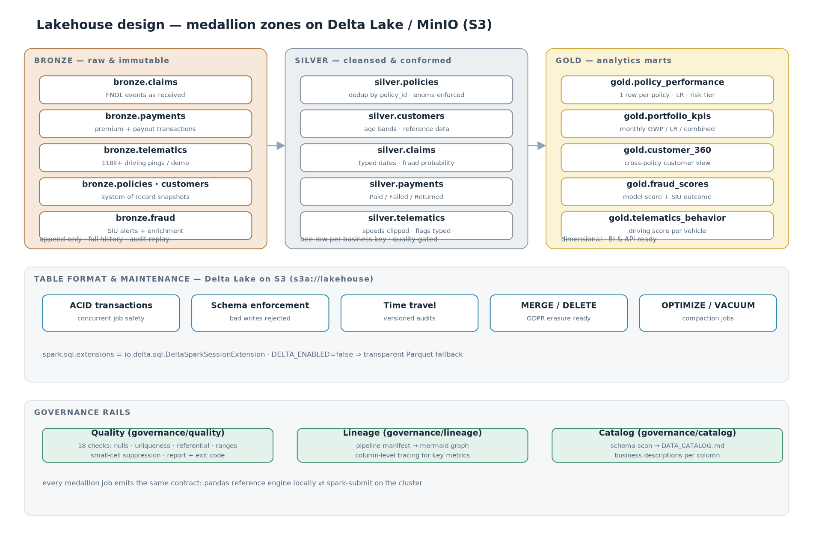
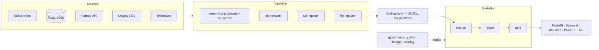

# 🛡️ Insurance Big-Data Lakehouse

**Meridian Mutual** — an end-to-end, production-patterned data platform for a fictional
P&C insurer: Kafka streaming → medallion lakehouse (Spark + Delta on MinIO/S3) →
actuarial analytics → ML fraud/churn/risk → governed serving via API, dashboard and BI.


> **Everything in this repo runs.** The included synthetic book of business
> (8,000 policies, 24 months, injected seasonality/fraud/churn signals) flows through
> every layer, and the numbers below are produced by the actual code, not mocked.

---

## Architecture







## Measured results (demo book, generated by `make demo`)

| Area | Metric | Value |
|---|---|---|
| **Book** | policies / customers / window | 8,000 / 6,000 / Jan 2024 – Oct 2026 |
| | claims · payments · telematics pings | 718 · 75,151 · 118,366 |
| | written premium · incurred | $7.50M · $3.47M |
| **Portfolio** | earned-basis loss ratio (actuarial review) | **58.0%** (target 68%) |
| | worst priced segment | Home × South — LR 121.6% |
| **Reserving** | paid-to-date → ultimate (chain ladder) | $2.54M → $3.75M |
| | **total reserve** with 500× bootstrap | **$1.21M** (p95 $1.58M) |
| **Fraud ML** | ROC-AUC / PR-AUC (5-fold CV, out-of-fold) | **0.588** / 0.102 (base 0.074) |
| | precision @ top-5% review queue | **11.4%** — 1.5× lift over base rate |
| **Churn ML** | ROC-AUC (5-fold CV) | **0.754** |
| **Governance** | data-quality suite | **18/18 checks pass** |
| **Tests** | pytest suite | **22/22 pass** |

## Quickstart

### ① One-command local demo (no Docker, no JVM)

```bash
pip install -r requirements-dev.txt
make demo          # data → medallion → actuarial → ML → quality/lineage/catalog
make dashboard     # Streamlit on http://localhost:8501
make api           # FastAPI docs on http://localhost:8000/docs
```

The medallion runs on the **pandas reference engine** (`spark/pandas_reference.py`)
— same table contracts as the Spark jobs, small-data path included on purpose.

### ② Full OSS stack in Docker

```bash
cp .env.example .env
docker compose up -d                 # Kafka (KRaft) · MinIO · Postgres · API · dashboard
docker compose --profile spark up -d  # + spark job runner
docker compose --profile query up -d  # + Trino over the lakehouse
docker compose --profile tools up -d  # + kafka-ui  (:8085)

make topics && make stream-demo      # push events through Kafka
make spark-bronze && make spark-silver && make spark-gold
```

### ③ Streaming replay (the priority focus)

```bash
python -m ingestion.kafka.topics
python -m streaming.claims_stream      --mode produce --rate 25   # producer
python -m streaming.claims_stream      --mode consume             # consumer → landing
python -m streaming.payments_stream    --mode produce --rate 60
python -m streaming.telematics_stream  --mode produce --rate 500  # high-volume feed
python -m streaming.fraud_stream       --mode consume             # + triage enrichment
```

Producers replay the synthetic book (keyed by business id, lz4, idempotent);
consumers flush to `dt=` partitions and commit offsets only after the flush.
The fraud consumer demonstrates **in-flight enrichment** (triage priority,
processing timestamp) before landing.

### ④ Tests & lint

```bash
pytest          # 22 tests: generator contract, medallion integrity,
                # chain-ladder maths (textbook triangle), ML gates, DQ, API
ruff check .
```

## Repository map

```
insurance-big-data-lakehouse/
├── README.md · Makefile · docker-compose.yml · pyproject.toml
├── architecture/          # architecture.png · data-flow.png · lakehouse-design.png (+svg)
├── common/                # config (paths/env/logging) · pyarrow IO (local ⇄ s3a) · dataset loaders
├── ingestion/
│   ├── kafka/topics.py    # topic creation (3 partitions, lz4, retention)
│   ├── api/               # mock partner quote API + retrying ingestor
│   ├── database/          # DDL for Postgres system-of-record + watermark extractor
│   ├── files/             # legacy CSV ingestor with schema validation
│   └── synthetic/         # ★ the generator: seasonality, latent driver quality,
│                          #   fraud & churn signal injection, 3 scales
├── streaming/             # ★ claims · payments · telematics · fraud streams
│                          #   produce ⇄ consume modes, keyed, batched flush
├── spark/
│   ├── bronze/            # raw JSONL → Delta with lineage metadata (4 jobs)
│   ├── silver/            # dedup · typing · conformance (5 jobs)
│   ├── gold/              # 6 marts: policy_performance · portfolio_kpis ·
│   │                      #   customer_360 · fraud_scores · telematics_behavior · claims_daily
│   ├── common_spark.py    # Delta+S3A session factory · save/load helpers
│   └── pandas_reference.py# ★ laptop-scale mirror of the whole medallion
├── dbt/                   # staging → marts (fct_claims, loss-ratio, pricing adequacy)
│                          #   + tests, SCD2 snapshot, Trino profile
├── actuarial/
│   ├── frequency/         # Poisson GLM (log-exposure offset)
│   ├── severity/          # Gamma GLM (log link)
│   ├── pricing/           # pure-premium indication + adequacy review (A/E)
│   └── reserving/         # ★ paid chain ladder + 500× bootstrap (p50/75/95)
├── ml/
│   ├── fraud/             # feature builder · CV model selection · scorer
│   ├── churn/             # LogReg vs HistGB, winner by CV
│   ├── risk/              # weighted-percentile composite score + tiers
│   └── models/            # artifacts + metrics.json + registry.json
├── governance/
│   ├── quality/           # 18 declarative checks · small-cell suppression · md+json report
│   ├── lineage/           # pipeline manifest → mermaid + column-level tracing
│   └── catalog/           # schema scan → DATA_CATALOG.md data dictionary
├── api/main.py            # FastAPI: /kpis/summary · /policies/{id} · /fraud/alerts ·
│                          #   /reserving/summary · /customers/{id}/profile …
├── dashboard/app.py       # Streamlit: portfolio · claims · fraud · telematics · reserving
├── powerbi/               # DAX measure pack + modelling guide
├── infrastructure/
│   ├── docker/            # Dockerfiles: spark · api · dashboard · streaming
│   ├── kubernetes/        # Strimzi Kafka, Postgres, api/dashboard, gold CronJob
│   ├── terraform/         # versioned+encrypted S3 lakehouse bucket, IAM role
│   └── trino/             # catalog over MinIO (file metastore)
├── tests/                 # 22 pytest tests incl. textbook chain-ladder triangle
└── docs/                  # architecture · data model · actuarial methods · governance
```

## The medallion contract

| Layer | Guarantee | Contents |
|---|---|---|
| **landing** | append-only JSONL in `dt=YYYY-MM-DD` partitions; replayable | raw events exactly as received |
| **bronze** | immutable capture + `_source_file` / `_loaded_at` lineage | all datasets |
| **silver** | one row per business key (latest-wins), typed, enum-filtered, bounded | policies, customers, claims, payments, telematics, fraud_alerts |
| **gold** | dimensional marts, BI/API-ready | 6 tables (see `docs/data_model.md`) |

Run it twice — jobs are idempotent (overwrite by contract), and `DELTA_ENABLED`
switches between Delta Lake (ACID, time travel) and plain Parquet with zero code
changes. `LAKEHOUSE_ROOT` flips storage between `./lakehouse` and `s3a://lakehouse`.

## Actuarial & ML, briefly

* **Frequency** — Poisson GLM with log-exposure offset; **severity** — Gamma GLM.
  Combined into a 15-segment pure-premium indication (`actuarial/pricing/output/`).
* **Reserving** — cumulative paid triangle by accident × development quarter,
  volume-weighted LDFs, and a nonparametric bootstrap of exposure cells for the
  reserve range. The maths is unit-tested against a hand-checkable triangle.
* **Fraud** — features span claim dynamics (severity percentile, reporting lag,
  prior claims, night/injury perils), payment behaviour and telematics. Models are
  selected by 5-fold stratified CV; alerting uses a **top-10% review queue**
  (quantile threshold) because calibrated probabilities on a 6-7% base rate never
  reach arbitrary absolute cutoffs. Override with `FRAUD_ALERT_THRESHOLD=0.42`.
* **Churn / risk** — payment-failure-driven churn model (AUC 0.75) and a
  weighted-percentile composite risk tier (1-5) per policy.

## Governance

```bash
make quality    # 18 checks → dq_report.{json,md}, exit 1 on failure (CI-ready)
make lineage    # mermaid graph + column-level tracing for key metrics
make catalog    # DATA_CATALOG.md — auto data dictionary over all 18 datasets
```

Try: `python -m governance.lineage.lineage --table gold.policy_performance --column loss_ratio`

## API surface (gold layer only)

| Endpoint | Purpose |
|---|---|
| `GET /health` | gold-layer readiness |
| `GET /kpis/summary` · `/kpis/monthly?product=` | monthly GWP/LR/combined/fraud |
| `GET /policies/{policy_id}` | performance mart row + risk tier |
| `GET /claims/{claim_id}` | claim + fraud score + SIU outcome |
| `GET /customers/{customer_id}/profile` | customer 360 |
| `GET /fraud/alerts?threshold=&priority=` | review queue (top-10% by default) |
| `GET /reserving/summary` · `/pricing/adequacy` | actuarial outputs |

## Configuration

| Env | Default | Meaning |
|---|---|---|
| `LAKEHOUSE_ROOT` | `./lakehouse` | storage root (`s3a://lakehouse` in Docker) |
| `DELTA_ENABLED` | `true` | Delta tables vs Parquet fallback |
| `KAFKA_BOOTSTRAP_SERVERS` | `localhost:9092` | broker for the streaming layer |
| `AWS_ACCESS_KEY_ID/SECRET`, `S3_ENDPOINT` | minioadmin | MinIO credentials |
| `FRAUD_ALERT_THRESHOLD` | *(empty = top-10% queue)* | absolute score cutoff override |

## Production roadmap

Short and honest — what a real deployment adds on top of this foundation:

1. **Orchestration** — Airflow/Dagster DAGs wrapping the Makefile stages, with
   data-aware scheduling and SLAs.
2. **Schema registry + Avro/Protobuf** on the Kafka topics;Debezium CDC replacing
   the watermark extractor.
3. **Stream processing upgrade** — Spark Structured Streaming or Flink consumers
   for sub-minute bronze latency (the landing contract stays identical).
4. **Feature store & model registry service**; champion/challenger for fraud.
5. **Row-level security** in Power BI + PII vaulting in silver.

## License

MIT — see [LICENSE](LICENSE). Fictional insurer, synthetic data, real engineering.
