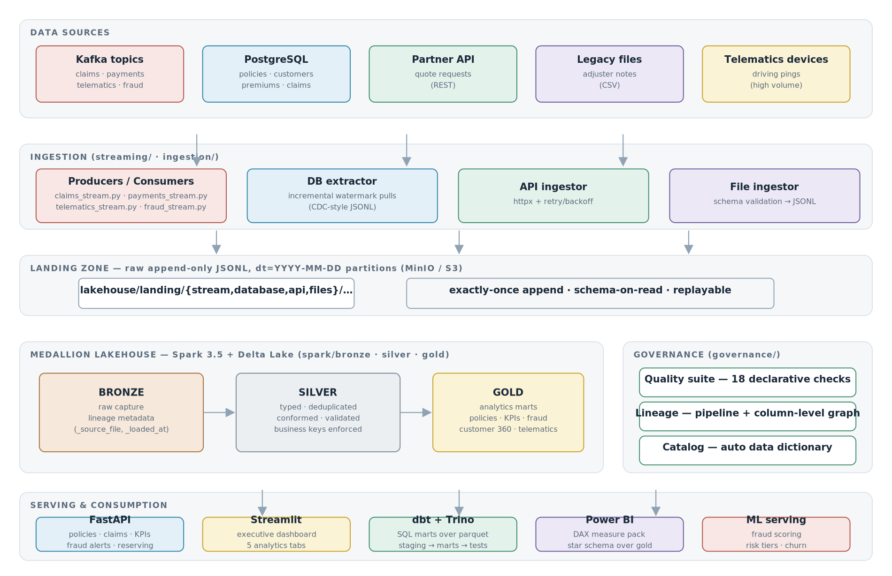
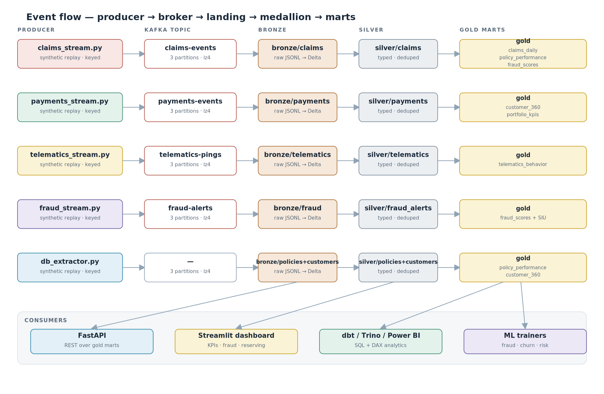

# Architecture

## System overview

## Layers

| Layer | Technology | Responsibility |
|---|---|---|
| **Sources** | Kafka (KRaft), PostgreSQL 16, partner REST API, legacy CSV, telematics feed | Where insurance events originate |
| **Ingestion** | `streaming/` (kafka-python-ng), `ingestion/database` (SQLAlchemy), `ingestion/api` (httpx), `ingestion/files` (pandas) | Move raw events into the landing zone |
| **Landing zone** | JSONL, `dt=YYYY-MM-DD` Hive-style partitions on MinIO/S3 | Raw append-only capture, schema-on-read, replayable |
| **Medallion** | Spark 3.5 + Delta Lake (`spark/bronze|silver|gold`), pandas reference engine (`spark/pandas_reference.py`) | Bronze capture → Silver conformance → Gold marts |
| **Transform (SQL)** | dbt (staging → marts → tests) on Trino/Spark Thrift | SQL-owned business logic over the lakehouse |
| **Governance** | custom quality suite, lineage manifest, catalog generator | Trust rails around every layer |
| **Serving** | FastAPI, Streamlit, Power BI (+ DAX pack), ML batch scoring | Consumption over gold only |

## Key design decisions

**1. Landing-zone contract.** Every ingester — streaming consumer, DB extractor,
API puller, file watcher — writes the same artifact: newline-delimited JSON in
`dt=` partitions. This makes the medallion layer source-agnostic and keeps the
streaming path replayable (a consumer crash never loses data; offsets are
committed only after the flush).

**2. Dual execution engine.** The medallion jobs exist twice:
`spark/*.py` (cluster) and `spark/pandas_reference.py` (laptop). They enforce
the same table contracts, so `make demo` runs the whole platform without a JVM
while the Spark path is what you promote to production. `LAKEHOUSE_ROOT`
switches the storage target between local disk and `s3a://` transparently
(pyarrow filesystem abstraction in `common/io.py`).

**3. Delta Lake with a Parquet escape hatch.** `DELTA_ENABLED=true` gives ACID
writes, schema enforcement and time travel; `=false` falls back to plain
Parquet when Delta jars are unavailable (e.g. minimal images), with no code
change.

**4. Fraud scoring in the lakehouse, not just in batch.** The fraud stream
consumer enriches every SIU alert with triage priority *on arrival*; the
trained model re-scores claims in batch (`ml.fraud.score_claims`), and the
gold `fraud_scores` mart joins both with SIU outcomes for feedback loops.

**5. Watermarked incremental extraction.** `ingestion/database/db_extractor.py`
stores `updated_at` watermarks per table — the same pattern Debezium-based CDC
would replace in production, without pretending to be real CDC.

## Failure isolation

* Kafka unavailability degrades streaming replay, not batch analytics.
* Partner API down → ingestor retries with exponential backoff, then stops
  cleanly (partial pages are kept — landing is append-only).
* A bad silver job cannot corrupt gold: gold jobs read only committed silver
  datasets and are idempotent (overwrite by partition contract).
